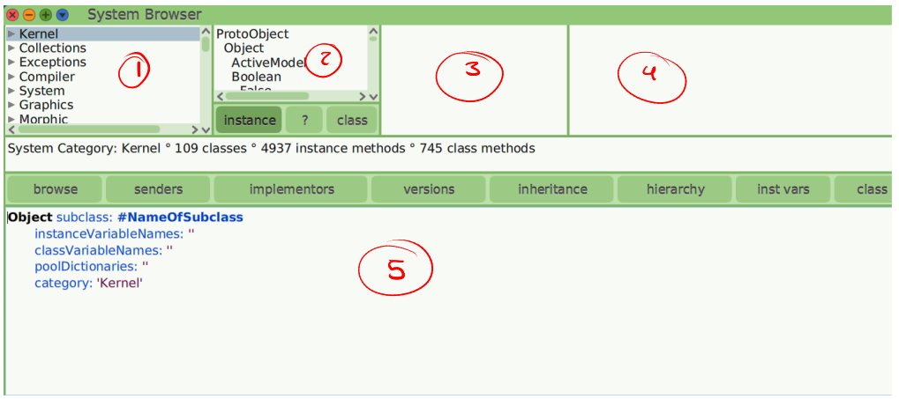
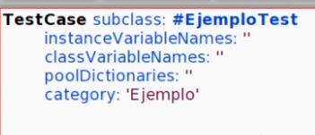
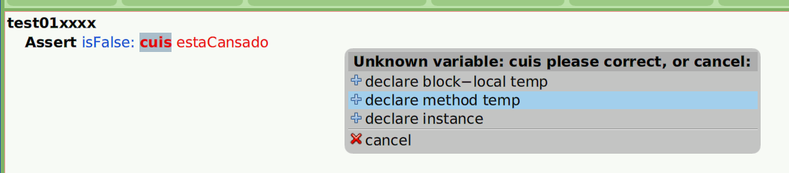
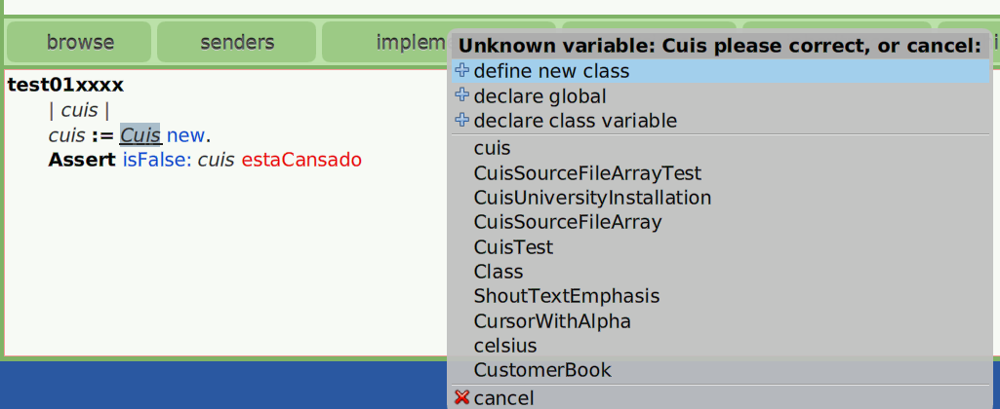
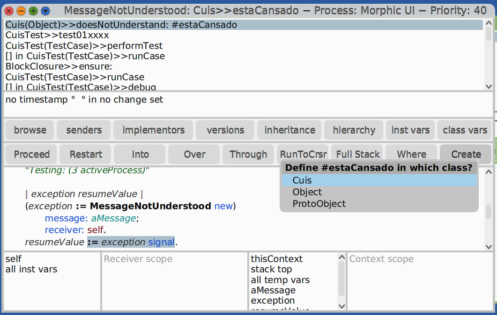
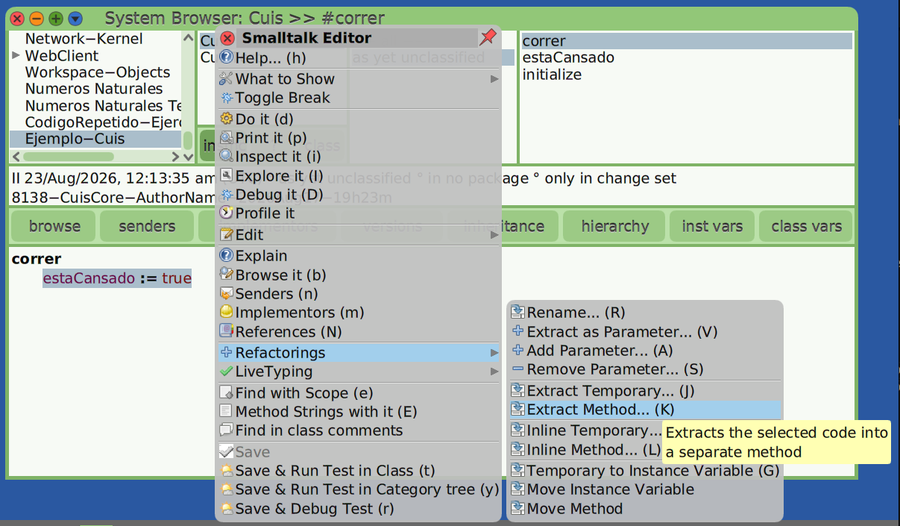
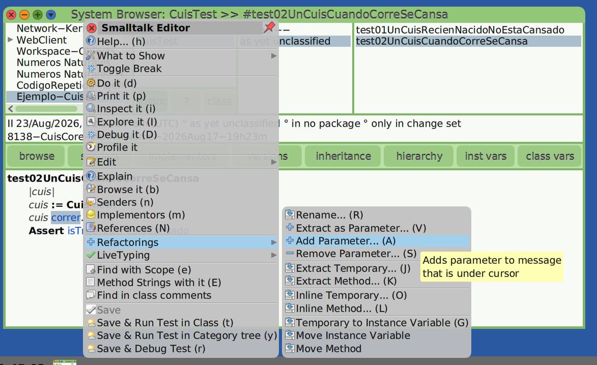

# Clases en Cuis University

## Browser de clases

El class Browser es el punto de entrada a todos los objetos del sistema, a sus mensajes, y nos permite modificarlos. 



* (1) Vemos una categoración de todas las clases que existen, llamadas también Paquetes.
* (2) Aquí vemos las clases correspondientes a (1)
    - **Instance**
    - **Class**: Podemos ver los mensajes a nivel de clase
* (3) Se encuentra la categoriazción de todos los mensajes definidas para un clase (2)
* (4) Vemos los mensajes
* (5) Observamos el método del mensaje o implementación de (2)

### Funciones Utiles

| Descripción | ¿cómo? |
|---|---|
| Buscar una clase | Click derecho -> 'find class... (f)'|
| Buscador general | `[Shift] + [Enter]` puede buscar de todo (no solo clases)|

Dentro del class Browser vemos pestañitas que sirven para lo siguiente:
* **`hierachy`**: Nos muestra la jerarquia completa de una clase
* **`senders`**: Nos permite ver todos aquellos lugares en las que se envia un mensaje. También podemos seleccionar el mensaje dentro de una implementación ver su senders -> Click derecho -> `senders of it (n)`
* **`implementers`**: nos muestra todos los lugares en donde se implementa un mensaje.

### Cómo crear clases y métodos de test

1. Abrimos el Class Browser
2. Click derecho en (1) -> `Add category... (a)` y le damos nombre 

Para poder definir nuestro tests, debemos definir una clase en el cuál se hallaran todos nuestros tests. OJO! Su superClase debe tener un nombre especial -> **`TestCase`**



> [!NOTE]
> Cuando hagamos `acept` para guardar los cambios, si es la primera vez que lo hacemos nos va a aparecer una pantalla; `Please type your initials:` esto es para llevar un registro de tus cambios. Si ya estas registrado te va a pedir que confirmes tu nombre y sí no te va a pedir tu nombre para registarte.

Luego implementamos nuestros metodos de test igual que en DenotativeObject Browser.
También tiene debugger.

## Ciclo completo de TDD

> Fases del Ciclo TDD
> 1. <span style="color: #D60606"> Red </span>: Escribe una prueba automatizada para una nueva función antes de crear el código de producción. La prueba debe fallar porque la funcionalidad aún no existe, lo que confirma que el test es correcto.
> 2. <span style="color: #1B8A04"> Green </span>: Escribe el código mínimo y más simple posible para hacer que la prueba pase con éxito. No te preocupes por la perfección en este punto, solo por cumplir el requisito.
> 3. **Refactorizar** (Refactor): Mejora el diseño del código, elimina duplicados y ordena la estructura sin alterar el comportamiento, asegurando que las pruebas se mantengan en verde.


Vamos a comenzar con un ejemplo. Supongamos que conocemos esto:
```
Implementar a un cuis que cuando corre más de 10km esta cansado
```

Asi que vamos a ver cómo plantear el primer test. Una buena forma de empezar es pensar qué pasa cuando un cuis no corre. Asi que vamos creando nuestros tests

```
TestCase subclass: #CuisTest
	instanceVariableNames: ''
	classVariableNames: ''
	poolDictionaries: ''
	category: 'Ejemplo-Cuis'
```

> [!TIP]
> Para que no perdamos tiempo en pensar en los nombres de los test es recomendable poner inicialmente algo como `test01xxxx` de esta forma sabremos que lo tenemos que cambiar.


**Paso Red y Green**\
Vamos implementando nuestro test, de que pasa cuando el Cuis nunca corrio.




- Vemos que cuando queremos guardarlo nos dice que declaremos la variable cuis, nos ofrece declararla como una variable temporal de un bloque, una variable dentro del metodo, o una instancia. En este caso elejimos la segunda.
- Luego confirmamos el selector estaCansado y Procedemos de todas formas.



- En este caso vamos a suponer que existe la clase Cuis
- `new` este mensaje existente pra todas las clases de SmallTalk, sirve para crear una instancia fresca de la clase.
- Al guardar definimos a Cuis como una nueva clase.


Al ejecutar el test veremos que nos manda al debugger (Porque `estaCansado` aún no esta definido para Cuis)



- Desde aquí podemos modificar el código y volver a ejecutarlo hasta que el test pase
- Hacemos clic en Create para crear un metodo para `estarCansado`
- Lo definimos dentro de la Clase Cuis, y todavia no lo categorizamos `as yet unclassified`

Luego modificamos la implementación de estaCansado dentro del Debugger, y por el momento (solo para que pasen los test) vamos a hacer que devuelva falso `^false`. Guardamos y procedemos con la ejecución `Proceed`.


**Paso Refactoring**
En este paso introducimos una modificación sin alterar su comportamiento. Por ejemplo podriamos cambiar el nombre al test: 
1. Click derecho sobre el mensaje test -> Refactorings -> `Rename... (R)`

Nota: SIEMPRE CORRER LOS TESTS DESPUÉS DE UN REFACTORING

### Segunda iteración de TDD con colaboradores internos

Nuevo test:
```
test02UnCuisCuandoCorreSeCansa
	|cuis|
	cuis := Cuis new.
	cuis correr.
	Assert isTrue: cuis estaCansado
```

Podemos crear un colaborador interno dentro del debugger simplemente asignandole un valor en la implementación dada -> estaCansado := True. Luego al guardarla la definimos como una instancia `declare instance`.

```
"Esta es una nueva función"
correr
    estaCansado := True

"Modificamos la función anterior"
estaCansado
    ^estaCansado
```

Ahora que declaramos un colaborador interno o variable interna. Vamos a necesitar de una función que la inicialice:

```
initialize
    estaCansado := false
```

Es **MUY IMPORTANTE QUE TENGA ESE NOMBRE** `initialize` porque de esta manera vamos a tener la inicialización del objeto por defecto.


### Extract Method

`Extract Method...` o `[alt] + [K]` nos permite mover un bloque de código de un metodo a uno nuevo y más pequeño, de esta forma mejoramos la legibilidad, y evitamos la duplicación sin alterar la ejecucuión del programa.




### Refactorings: Add Parameter / Remove Instance Variable
Ahora aquí vamos a agregar el requisito de los 10km que mencionamos al inicio del ejemplo.
Para ello vamos a modificar correr (unary) a correr: unaDistancia (keyword).

Para ello podemos cambiarlo de las siguientes formas:

1) Manualmente
2) Desde los test como vimos anteriormente, agregando ->  correr: unaDistancia
3) Con *Refactoring*:\
    
    Cuyo nombre de parametro será -> `unaDistancia`\
    Y el valor que vamos a enviarle (en este caso) para que el test pase sera una distancia mayor a 10km -> `11 * kilometer`\
    Luego nos preguntara el alcance para aplicar nuestros cambios, y en este caso sera en esta categoria. Luego confirmamos los cambios -> click en `Refactor`

La nueva modificación estara en las clases Cuis y CuisTest

```
"Cuis class"
correr: unaDistancia
	self cansarse

"CuisTest class"
test02UnCuisCuandoCorreSeCansa
	|cuis|
	cuis := Cuis new.
	cuis correr: 11 * kilometer.
	Assert isTrue: cuis estaCansado
```

Confirmamos CORRIENDO LOS TESTS (Run Test)


Ahora vamos a crear otro test, en donde el Cuis no este cansado
```
test03
	|cuis|
	cuis := Cuis new.
	cuis correr: 8 * kilometer.
	Assert isFalse: cuis estaCansado
```
Si lo corremos esto obviamente nos va a lanzar error y nos enviara al debugger. 
Desde el debugger entramos a la implementación de correr (restart en test03 y over e Into)


**Formas de Correción** ----------------------------------------------------------------------------------------------------------------------------------------------------------------

**(Primera forma)** Podemos crear una nueva instancia, `distanciaRecorrida`

```
correr: unaDistancia
	distanciaRecorrida := unaDistancia
```

Y en base a esto modificar también estaCansado
```
estaCansado
	^distanciaRecorrida > (10 * kilometer)
```

El test3 pasa correctamente. PERO! Si corremos todos los tests veremos que el test01 no pasa. Debuggeamos de nuevo!\
Notaremos que el error esta en estaCansado y eso pasa ya que `distanciaRecorrida` es nil por defecto. Asi que para corregirlo inicializamos esta variable interna correctamente en nuestro mensaje de **`initialize`**.


*ELIMINAMOS LO QUE NO USAMOS*
- En este caso el metodo `cansarse` -> click derecho sobre el mensaje -> `Remove Method (X)`
- Eliminamos la variable interna `estaCansado` -> Click derecho sobre el menú de clases -> Refactorings -> `Remove Inst Var...` -> `estaCansado`. En este caso no ve a dejar ya que tiene referencias, asi que click en `Browse references` y lo eliminamos Manualmente. Posterior a esto volvemos a intentar el refactoring.


**(Segunda forma)** Vamos a crear otro test para ver que la primera forma no es suficiente para verificar la distancia recorrida de un Cuis.

```
test04
	|cuis|
	cuis := Cuis new.
	cuis correr: 8 * kilometer.
	cuis correr: 4 * kilometer.
	
	Assert that: cuis distanciaRecorrida isEqualTo: 12 * kilometer
```

Si corremos este test nos dará error ya que no hemos definido el mensaje `distanciaRecorrida`. Asi que de nuevo entramos al debugger -> `Create` dentro de la clase Cuis y sin clasificar, y veremos que nos sugieren en su implementación devolver el valor de la instancia `distanciaRecorrida`. Lo guardamos y continuamos.\
Por último nos dara otro error, pero esta vez será por no un resultado inesperado. Se esperaba 12 y devolvió 4, claramente no esta guardando la distancia anterior.\
Desde el debugger volvemos a test04 -> restart -> Into en correr y lo modificamos para que guarde la distancia anterior. Y Listo!

> [!NOTE]
> Para ver la implementación completa descargar -> [Ejemplo-Cuis](Ejemplo-Cuis.st) y File In en browse class.


